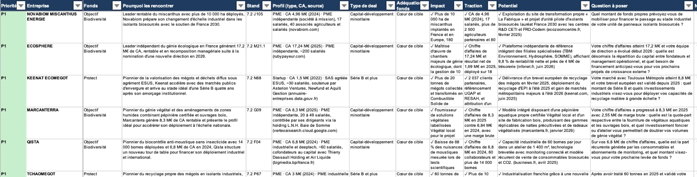
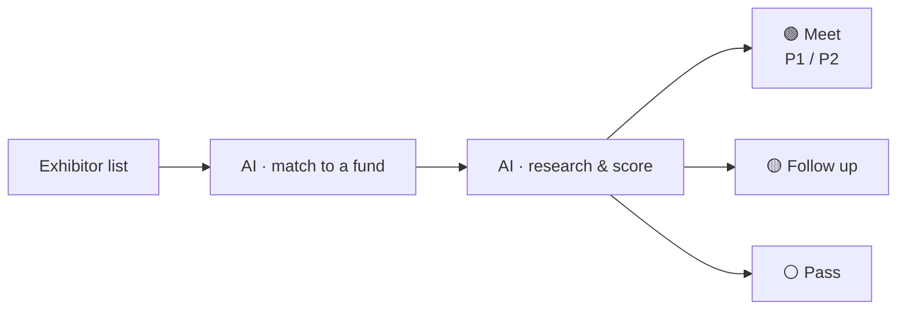

# Starquest · AI dealflow screening (n8n + Gemini)

An n8n workflow that screens the exhibitors of a trade show for Starquest, a climate & impact VC, and tells the investment team **which companies to meet on their stand, and why**. Each company is researched live on the web by Gemini, matched to one of Starquest's three funds (Protect, CCR-F, Objectif Biodiversité), and written to a Google Sheet with every proof linked to its source.

## Results
Run on the Salon des maires and Salon de la biodiversité (1,385 exhibitors, 186 startups shortlisted):

| 186 startups screened | 95 fit a fund's mandate | 58 ranked | **33 to meet** |
|:-:|:-:|:-:|:-:|
| | | | 14 P1 · 19 P2 (+25 P2 with reservations) |

## Workflow

## How it works
A first AI call identifies the company and assigns it to the fund whose thesis matches its core business; anything off-thesis is passed straight away. A second call checks the company against that fund's criteria (size, stage, independence, ticket size), then looks for three sourced proofs: **Impact**, **Traction** and **Potential**. The final ranking is computed by code, not by the AI: impact is mandatory (Article 9 funds), and the more proofs are confirmed by a real source, the higher the priority.

## Limits & next steps
- **Web data only:** the analysis relies on what Google can find. Connecting PitchBook, Dealroom or company registries would give more reliable financials and funding data.
- **Pass/fail proofs:** each factor is only confirmed, claimed or missing. A scoring system (e.g. 1–5 per factor) would rank startups more precisely.

---
`workflow/starquest-dealflow-screening.json` can be imported into n8n (**Import from file**). The exhibitor list has been replaced with example companies.
