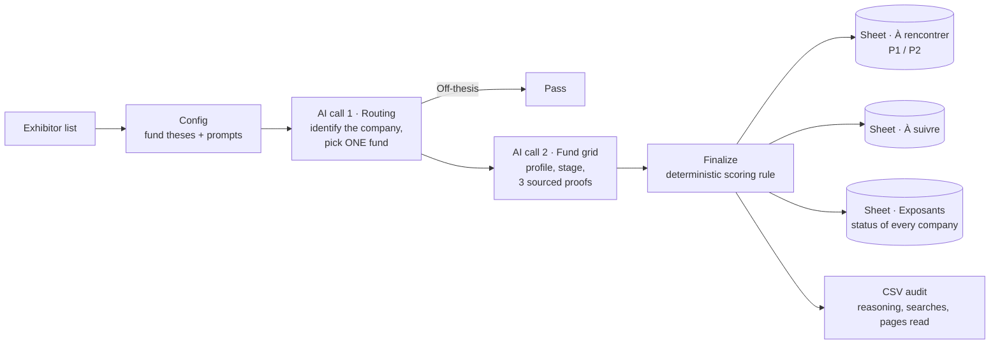

# Starquest · AI dealflow screening (n8n + Gemini)

An n8n workflow that screens the exhibitors of a trade show (Salon des maires, Salon de la biodiversité, Paris) for a climate & impact VC, and tells the investment team **which companies to meet on their stand, and why**.

Each company is researched live on the web by Gemini (Google Search grounding), matched to one of three Starquest funds, scored against that fund's investment grid, and written to a Google Sheet with every proof clickable back to its source.

> The workflow's prompts and comments are in French, the language the team works in.

## What it does



### 1. Routing (AI call 1)
Gemini searches the company on Google, describes in one sentence what it sells and to whom, and attaches it to **one** fund based on its core business:

| Fund | Thesis | Ticket |
|---|---|---|
| **Protect** (Art. 9) | Decarbonisation & resource protection: energy efficiency, renovation, industrial decarbonisation, low-carbon mobility, circular economy, renewables | €3–15M, growth capital |
| **CCR-F** | Natural-catastrophe prevention & climate adaptation: floods, clay shrink-swell, wildfires, monitoring sensors, climate-risk data, resilient infrastructure | €0.5–10M, seed to LBO |
| **Objectif Biodiversité** (Art. 9) | Preserving & restoring nature: regenerative agriculture, biocontrol, depollution, ecological engineering, sustainable aquaculture, forestry, urban nature | €3–20M, seed to LBO |

Companies clearly outside all three theses are passed without a second call (saves cost); in doubt, the model is told to keep them, because wrongly rejecting a good company costs more than analysing one too many.

### 2. Fund grid (AI call 2)
With the chosen fund's prompt, Gemini follows the grid an analyst would use:
1. **Profile**: identity, latest published revenue (with year), independence, shareholders and recent fundraising. Size and stage are checked against the fund's ticket.
2. **Thesis**: is the core business in one of the fund's verticals? Explicit exclusions per fund.
3. **Three proofs**, each rated ✓ (sourced, specific, figures), D (claimed only) or ? (not found):
   - **Impact**: measurable, in the fund's unit (tCO₂ avoided, MWh saved, hectares restored…)
   - **Traction**: revenue, headcount, named clients or contracts
   - **Potential**: fund-specific (commercial acceleration for Protect, proprietary asset or replicable model for the others)

The answer is forced into a **JSON schema** (status, fact, source URL, site, date for each proof) so it can be parsed reliably.

### 3. Scoring (code, not AI)
The final priority is recomputed deterministically from the proofs, so the model can't "talk itself into" a result:

- **Impact ✓ is mandatory** (Article 9 funds)
- **P1**: Impact ✓ + Traction ✓ + Potential ✓ and relevance 3/3
- **P2**: Impact ✓ + at least one other ✓
- **À suivre** (follow up): impact or proofs incomplete
- **Pass** otherwise, with the reason and the step at which it was rejected

A proof only counts as ✓ if it comes with a real source URL.

### 4. Output
- **Google Sheet**: `À rencontrer` (P1/P2, with "why meet them" and a question to ask on the stand), `À suivre`, and `Exposants` (status of every company, including passes and why)
- **CSV audit**: the model's reasoning, the searches it ran and the pages it read, plus a check that the scoring rule was applied

## Engineering details
- **Two-call design**: a cheap routing call filters off-thesis companies before the expensive research call.
- **Grounded research**: Gemini's `google_search` + `url_context` tools; the model is instructed never to rely on memory and never to invent URLs.
- **Retry layer**: each Gemini call has a retry check and a second attempt for failed or malformed responses.
- **Batching**: requests go out in batches of 5 with a 120 s timeout.
- **Single config node**: model, limits (`limit`, `offset`, `only` to re-run a few companies), Sheet ID and every prompt live in one place.

## Run it yourself
1. In n8n: **Workflows → Import from file** → `workflow/starquest-dealflow-screening.json`.
2. Add two credentials: **Google Gemini (PaLM) API** and **Google Sheets OAuth2**, and select them on the Gemini and Sheet nodes.
3. In the **Config** node, set `spreadsheet_id` to your own Sheet (tabs `À rencontrer`, `À suivre`, `Exposants`). Set `limit: 10` for a test run.
4. In **Entreprises étape 1**, replace the example companies with your exhibitor list.
5. Click **Lancer le screening**.

## Repository
```
workflow/starquest-dealflow-screening.json   the n8n workflow (importable)
```
The exhibitor list has been replaced with example companies. No API keys are included: n8n stores them separately, and the file only references them.
